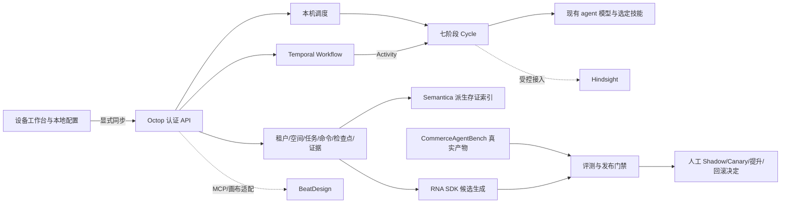

# BM 多租户、长程任务与受控进化

本文说明按照根目录 `BM-20260928-v1.1.pptx` 接入 Octop 的控制面、适配器及其边界。实现以 Octop 原有 FastAPI、SQL 仓储和 React 工作台为主，不修改各上游项目。本文中的“已实现”指代码路径存在；远端连通、生产隔离、真实经营收益需要各自验收，不能由单元测试代替。

## 使用入口和数据归属

登录后打开“长程工作台”。登录页和服务不可达提示也提供 `/offline-workbench` 入口。设备端先保存可迁移的工作流配置；用户显式上传后，服务端将配置保存到“租户 / 当前用户 / 独立空间”。在另一台设备登录同一账号，选择同一租户和空间后显式下载配置。上传、下载均保留版本号，冲突返回 409，用户先读取新版本再决定如何覆盖。

租户具有 owner、admin、member、viewer 成员关系。全局 Octop 管理员不自动获得租户成员权限。空间归当前用户所有；同租户的其他成员不能因此读取该用户的私有配置。任务同时绑定租户、空间和创建者，服务在实际执行前重新检查成员和 agent 所属关系。

设备配置使用浏览器本地存储。它适合工作流、目标及公开参数，不是凭证库，也不提供 SQLCipher 或操作系统钥匙串保证。服务端同步检查凭证字段、明显密钥和绝对主机路径。模型密钥、登录状态、原始私有文档和机器路径应留在本机，由现有 Octop 配置及凭证机制管理。没有安装资源缓存的纯网页，首次启动仍需要取得前端资源；不能把本地配置持久化解释成任意浏览器都能完全断网冷启动。

“local”执行模式由该终端上的 Octop 服务推进任务；可使用本地模型。断网时，云模型、远端记忆、外部编排服务不可用。本地流程编辑和 `local.echo` 节点可用于检查配置和调度；它们不产生模型能力、真实业务执行或经营成果的证明。

## 与 PPT 的对应关系

| PPT 页码 | 目标 | 本次实现 | 仍需上线验收的部分 |
| --- | --- | --- | --- |
| 9–10、44、46 | 设备优先、独立空间、多租户 | 本地配置、显式同步、成员授权、私有空间、SQL 租户范围 | 原生加密存储、设备证明、独立 OAuth audience、真实数据库 RLS 对抗验收 |
| 11–17 | 冻结计划、Goal / Cycle、七阶段 | DAG 编译与摘要、检查点、依赖/并发/超时/次数边界、六种周期决定 | 完整业务 GoalSpec、FactSetRevision、独立 StageRevision、平台事实接入 |
| 18–22、33 | 正式副作用、授权、回读、保护 | 明确风险档、计划绑定授权、写前意图、未知结果停机、受控扩展接口 | 逐业务能力的幂等、回读、账本、ProtectionState 原子门禁和对账恢复 |
| 24、28–30 | 历史经验可撤销、可追溯 | Hindsight 独立 bank、来源/租户/TTL 元数据、召回过滤、显式删除接口 | 记忆投毒门禁、真实跨租户/跨店攻击测试、生产 retain/reflect 准入 |
| 31–33 | 多技能、多 agent、工作流资产 | 节点指定已有 agent / skill、依赖和并行；BeatDesign MCP 适配与画布导入 | BeatDesign 多租户隔离部署、具体业务技能和能力合同 |
| 34 | 运行记录与存证 | SQL 顺序事件与哈希链；Semantica ProvenanceManager 派生索引 | 对象存储 WORM、外部签名/时间戳、独立审计与保留政策 |
| 35–40 | 过程健康、目标结果、固定评测 | CommerceAgentBench 真实结果导入、明确分母、固定基准配对评估 | 真实业务 Gold、成熟观察窗、合格对照、归因统计与质量门禁 |
| 41–42 | 版本发布、Shadow / Canary / 回滚 | RNA 真实候选生成桥接；硬断言和受控状态迁移 | 实际 Shadow/Canary 运行、逐能力发布与回滚演练；候选状态本身不执行部署 |
| 43、45、47 | Temporal 与工程运行 | `temporalio` Python SDK、确定性 Workflow、Activity、Timer/Signal、worker | Temporal 服务/命名空间/TLS、历史回放和故障恢复的部署验证 |

PPT 第 41 页中的 JEV/Hindsight 历史实验数字和 NO_GO 是原资料的实验快照。本实现没有运行那些相同试验，也没有把它们改写为当前系统 GO。JEV 的模型判别仍不能赋予权限；此次不新增未经校准的 JEV 审批入口。

## 运行模型



Cycle 按 Observe → Diagnose → Plan → Compile → Act → Verify → Evaluate 推进。检查点保存当前阶段、轮次、节点结果、计划摘要及下一步决定。普通 `cycle` 增长不创建新的业务阶段。`continue`、`replan`、`sleep_until`、`human_required`、`achieved`、`stopped` 都有独立语义；缺少独立目标证据时，不把工具成功或模型回答解释为 `achieved`。

当轮 Observe 事实与 Diagnose 的质量、来源引用会传入每个 agent 节点，并与依赖输出一起计入预算。Plan 使用用户已冻结的 DAG，不自行生成新的生产业务策略。`human_required` 暂停后，人工恢复会在剩余轮次内重新 Observe，避免反复评估旧回读；`replan` 必须修改工作流后新建任务，原任务的恢复命令返回 409，保持原审批摘要有效范围。

R0 agent 节点仅调用已有模型，使用该 agent 的 system prompt 和选定 `SKILL.md`，不向模型绑定工具。多 agent 通过多个有依赖的节点组合。R1/R2 未注册符合 effect、scope、幂等、回读与保护约束的受控适配器时拒绝出站；R3 在本版本禁用。上游支持 MCP 不等于已经具备具体店铺、动作和金额的业务合同。

创建任务时，HTTP 控制面异步读取所选 agent 工作区的技能文件，将 system prompt、model_ref、skill_text、skill_digest 及 provider kind/base_url 的摘要冻结为每个节点的 `behavior_snapshot`，并纳入 plan_digest。自定义技能文本最多 32000 字符。之后修改 agent 设置不会悄悄改变既有任务；执行使用冻结内容，同时重新检查 agent、租户权限和模型提供方是否仍有效。提供方类型或地址变化、快照技能摘要不一致会拒绝执行。凭证不进入快照，仍由设备的当前安全配置提供。

R0 采用保守预算保留：工作流 `max_tokens` 默认 32768，最大 2000000；节点 `max_output_tokens` 默认 2048，最大 8192。每批出站前，按目标、输入、冻结行为和依赖结果的规范 JSON UTF-8 字节数，加 1024 开销和输出上限预留，超预算即停止；`local.echo` 保留量为 0。这是预算估计，不能当作真实 token 测量。实际回包提供 `usage.total_tokens` 时按实记账；缺失时将总量标为 null，增加 `unknown_actions`，并按保留量扣减预算。检查点单列 `known_total_tokens` 与 `budget_consumed`，动作证据保留 reserved、measured、charge；真实货币费用与资金账本仍需业务适配。

SQL 仓储是权限、任务和检查点的权威。命令携带 `expected_revision` 与幂等键；冲突不覆盖新状态。持久化的 action intent、稳定幂等标识和运行租约用于恢复判断。已可能发生外部副作用却没有确定回读的动作进入 `uncertain`；恢复时先对账，不能因为超时就盲重发。Temporal 的重放并不提供跨外部系统的 exactly-once 交易语义。

恢复会从已提交的 action_completed 重建未提交的检查点，防止重复执行已有确定结果的节点。相同稳定幂等键下的多次 R0 派发仍分别占用动作与 Token 预算；写入意图未决或写入失败时进入 uncertain，明确未派发的意图不扣出站预算。暂停、恢复与活动提交并发时，以最终 SQL 状态为准。

## 可信事实和目标回读

显式配置 `OCTOP_FACT_REPORTS_ROOT` 后，Observe 和 Verify 从以下目录读取运维或可信事实适配器产生的报告。目录写权限必须独立于 HTTP 调用者和模型；创建任务不能供应报告正文或改变事实目录。

```text
OCTOP_FACT_REPORTS_ROOT/
  sha256(tenant_id)/space_id/task_id.json
```

报告为不超过 256 KiB 的 JSON 对象，解析后的路径必须留在当前空间目录。合同如下：

| 字段 | 校验 |
| --- | --- |
| `schema_version` | 必须为 1 |
| `tenant_id`、`space_id`、`task_id`、`plan_digest`、`cycle` | 与当前任务、冻结计划及轮次一致 |
| `observed_at`、`expires_at` | UTC 时间；观测不能在未来，到期时间必须晚于当前时间和观测时间 |
| `evidence_refs` | 非空来源证据列表 |
| `facts`、`quality` | facts 为对象，quality 必须为 `fit` |
| `goal_outcome` | 显式为 `achieved`、`not_achieved` 或 `inconclusive` |
| `readback_confirmed`、`observation_window_complete` | achieved 时均必须为 true |

任务 acceptance 指定 `metric_revision`、`scope`、`currency`、`timezone`、`source_ids` 时，报告必须逐项完全匹配。Verify 的观测时间不得早于检查点的 `last_action_completed_at`，防止复用执行前的回读。若 acceptance 指定正数 `observation_window_seconds`，achieved 报告还须提供 `observation_window:{started_at,ended_at}`；窗口长度满足要求，结束时间不得晚于 observed_at。

读取和校验在 executor 中运行，报告以 `facts.frozen` 写入任务证据链，保留 projection_digest 和原始来源引用。Evaluate 只依据可信 Verify 投影决定目标结果，可接收 `cycle_decision` / `sleep_until`，但仍经运行时边界校验。未配置事实源时，模型回答、节点执行成功和基准导入均不能把在线目标从 inconclusive 改成 achieved。

## 安装与 Temporal

使用 Octop 支持的 Python 环境；同时启用本地 Semantica 0.7 时选择 Python 3.12 或 3.13。先按 Octop 原有方式完成数据库、用户、agent 与模型设置。

```powershell
cd Octop
uv sync --extra longterm-temporal --extra longterm-memory
# 与本工作区的确切 Semantica 源码保持一致；该项目依赖较多。
uv pip install -e ../semantica
uv run octop run
```

本地调度不需要 Temporal。需要持久计时、跨进程等待和 Temporal 历史时，先独立部署 Temporal Server。仓库中的 `temporal/` 是上游源码，不会随 Octop 自动启动。

```powershell
$env:OCTOP_TEMPORAL_ADDRESS = 'localhost:7233'
$env:OCTOP_TEMPORAL_NAMESPACE = 'default'
$env:OCTOP_TEMPORAL_TASK_QUEUE = 'octop-longterm'
uv run python -m octop.infra.longterm.worker
```

Web 服务和 worker 使用同一个 Octop 数据库与同一组 Temporal 地址、namespace、task queue。远端部署还需在运行环境提供 `OCTOP_TEMPORAL_TLS=1` 和凭证引用对应的 `OCTOP_TEMPORAL_API_KEY`。Workflow 只做确定性调度；模型、数据库和第三方访问在 Activity 中运行。Activity 不对未知写入自动重试。worker 和服务都必须保持任务租约与数据库权限边界。

worker 是最小数据库进程：加载 `OCTOP_HOME` 的配置、迁移、SharedServices 和 LongtermService，通过 Activity 调用相同的 step。它不启动 OctopServer、HTTP、IM/gateway、cron、主动关怀或本机恢复调度。启动前须完成 Octop 数据库初始化；退出时关闭服务和数据库。`python -m octop.infra.longterm.worker --healthcheck` 会实际连接 Temporal，检查本容器/主机的 task queue poller。

多进程开发部署可使用 [长程任务 Compose 说明](../docker/README.longterm.md)，它为 API 与 worker 共用 PostgreSQL，单独持久化开发 Temporal 服务。Compose 配置检查与真实容器构建、远端集群验证是不同的验收步骤。

## 七个组件的真实接入方式

| 组件 | 接入 | 配置或部署 |
| --- | --- | --- |
| Octop | 前端、认证 API、SQL 权威控制面、本地调度 | 原有 Octop 用户、agent、模型与数据库配置 |
| Semantica | `semantica.provenance.manager.ProvenanceManager`；`track_entity` 后回读摘要确认 | 单独安装确切上游源码；按租户建立派生 SQLite 索引 |
| BeatDesign | 实际 MCP Command Kernel；项目绑定与允许工具清单；画布语义导入 | 部署上游服务、MCP 连接和租户→项目映射；互不信任租户使用独立实例/数据目录 |
| CommerceAgentBench | 读真实 `manifest.json`、`verifier/final_reward.json`、`agent/trajectory.json` | 运维运行真实 CLI 并放置产物；`OCTOP_BENCH_RESULTS_ROOT` |
| RNA | Node ESM 桥接真实 `proposeEvolution`；另有基因服务 HTTP 适配 | Node ≥22.19，`OCTOP_RNA_SDK_ROOT`、模型 JSON 与凭证环境变量名 |
| Hindsight | 官方 `hindsight_client.Hindsight` 异步 retain/recall/document deletion | `OCTOP_HINDSIGHT_URL`，可选 `OCTOP_HINDSIGHT_API_KEY`；部署上游服务 |
| Temporal | 官方 `temporalio` Python SDK 与独立 worker | `OCTOP_TEMPORAL_*`，实际 Temporal 服务 |

工作台集成列表的 available/configured 仅表明本地模块或配置存在，不表示远端健康检查通过，也不是上线验收结论。

Hindsight 写入需要用户明确同意、可核查证据和已验证目标结果。每个租户使用哈希派生的 bank，条目带来源和到期时间。上游 retain 没有可直接依赖的原生 TTL 参数，因此适配器在召回时过滤过期项，并提供显式文档删除；它不声称后台已有自动 TTL 清理器。历史记忆不覆盖当前价格、库存、余额、权限或政策。当前不自动启用 reflect，也不将未经生产安全门禁验证的记忆写入放行为默认能力。

Semantica 是可查询的来源/关联索引，不是外部公证机构。先保留 SQL 中的原始证据链，再显式导出索引；索引不可用时不得伪报导出成功。现阶段哈希链能检出正文与链接不一致，不能抵抗能同时重写数据库及所有摘要的管理员。

BeatDesign 本身具有单用户部署假设。项目映射可以防止本适配器误选项目，不能替代上游 RBAC。Octop 的 DAG 是执行合同，BeatDesign 用于多技能资产和编排交互；媒体生成工具的支持也不能推导为任意业务 agent 都已安全接入。

## CommerceAgentBench 结果导入

在其独立 Python 环境按上游 README 安装 CLI。需要 Docker、固定 runtime 镜像以及实际配置的模型/评判提供方。可以先执行 `commerce-agent-bench list` 验证任务集合，再按已有 provider 配置运行一个任务，例如：

```powershell
commerce-agent-bench run --config configs/openclaw_native_google_direct.yaml --limit 1 --run-id bm-smoke
```

这个命令仍需要上游配置指定的真实凭证与模型服务；没有配置时不能生成“通过”结果。它运行 Commerce 基准所指定的 harness，不自动证明 Octop 任意 agent 或经营目标已经通过。评估 Octop 行为版本时，还必须编写与该行为匹配的 harness/环境适配。

运维将单任务结果目录保留在：

```text
OCTOP_BENCH_RESULTS_ROOT/
  sha256(tenant_id)/space_id/run_id/
    manifest.json
    verifier/final_reward.json
    agent/trajectory.json
```

导入 API 只接受此空间下的相对 run 目录，并可校验 benchmark task ID。原始文件 SHA256 随报告保存；路径逃逸、超大产物、任务不匹配、manifest 与 final reward 冲突会被拒绝。暂不导入 collection 的聚合 summary 来冒充逐例结果。

报告分开呈现 `execution_health` 与 `goal_outcome`。agent 进程退出码为 0 不代表 verifier 通过；非零退出也不覆盖真实 verifier 已确认的成功。缺少完成的 verifier 或明确 verdict 时，结果保持 `unverified`，score 为 null。数值不合法的分数不会从 `passed=true` 推算。上游生成的 proxy request 步数保留为 `proxy_requests`，不冒充实际工具调用数。

长程指标包括真实记录的耗时、步骤来源、工具错误、token 和校验项数。上游没有记录的重启恢复率、Cycle 数量保持 null。运行事件指标按 PPT 第 39 页明确分母：已到期且具备执行条件的节点、实际获授权的动作；等待审批和 uncertain 单列。工具 `succeeded` 只有具备独立 verified/readback 证据才计作 confirmed。评测报告既不改变在线任务是否达成，也不产生 verified_uplift。

## RNA 候选、固定基准与发布决定

服务端配置 `OCTOP_RNA_SDK_ROOT` 为本地 `rna_dev/packages/sdk` 的绝对路径；`OCTOP_RNA_MODEL_JSON` 使用 SDK 的 ModelConfig，至少包含 providerId、modelId、protocol、baseUrl、contextWindow 和 maxOutputTokens。`OCTOP_RNA_API_KEY_ENV` 保存凭证环境变量的名字，而不是密钥。密钥放入该指定变量，保持设备本地。可用 `OCTOP_NODE_BINARY` 指定 Node 可执行文件。

RNA baseline 的数据结构是 `strategy`、`skills:[{id,instructions}]` 与 `assignments:{skillIds,toolIds,mcpServerIds}`；每个已分配 skill 必须有且只有一个快照。可以省略 projectId，由宿主绑定空间项目；若提供则必须匹配宿主项目。真实 SDK 只返回待检验的 proposal，不返回自造 score。桥接不执行模型工具，不执行候选代码，不改变权限；输入/输出限制 512 KiB，超时终止子进程，错误不回显 provider 正文和凭证。

手工候选与 RNA 候选都冻结租户、任务、baseline revision、benchmark revision、来源证据和 proposal digest。嵌套权限、tool assignment、policy 或 evaluation suite 字段会被拒绝。候选不能改写其评价标准。

新候选的 baseline revision 使用当前 `active_behavior_revision`，尚无活动行为版本时回退任务 plan_digest。RNA 另外保留所提交 baseline 快照及其本地校验摘要、SDK 版本、usageReported 和原始 usage；生成审计的摘要进入候选证据引用和 candidate_digest，后续评估及迁移会重新检查。缺失用量保持未知，不以 0 代替。

可信运维评测报告存放在：

```text
OCTOP_EVOLUTION_REPORTS_ROOT/
  sha256(tenant_id)/space_id/candidate_id.json
```

此目录应只允许运维评测任务写入。HTTP 调用者不能通过自报 `hard_gates=true` 或 `canary_readiness=true` 直接放行。文件最多 512 KiB，解析后的路径必须留在当前空间目录；读取、JSON 解析和评估在 executor 中运行。报告必须包含冻结的 baseline_revision、benchmark_revision、candidate_digest，状态迁移时也须匹配；逐例 `pairs` 用同一 case_id 配对 baseline/candidate 的真实 score、passed、safety_passed 和 evidence_refs；顶层提供 hard_gates 及证据。评测执行方负责保证 case ID 对应独立样本，不能把重复运行改名为独立样本。

默认至少 3 个独立用例、均值提升至少 0.01、任一逐例不得退化；tenant_isolation、authorization、external_side_effects 三项硬断言任一失败或缺失均为 NO_GO。总分不能抵消安全失败。报告和候选摘要不匹配即拒绝。

通过离线评测后顺序为 `evaluated → shadow → canary → promoted`。进入 canary 还需要独立的 authorization、idempotency、readback、protection_state、recovery 门禁。canary、promoted、rolled_back 必须由租户管理员显式请求，并校验当前活动版本。canary 或已提升版本可回滚至冻结基线。所有历史候选和 verdict 保留。

这里的发布状态是审计及版本控制记录。当前还没有把候选策略自动部署成新的生产 agent，也没有在状态变成 canary 时自动发送外部业务写入。真正启用行为版本需要单独的逐能力执行适配、Shadow/Canary 观察证据和回滚发布器。不要把状态迁移页面解释为已经取得生产效果。

## 验证和剩余验收

本次完整回归、真实 PostgreSQL/Temporal、浏览器检查与未完成验收，见 [BM 集成验证记录](bm-validation.md)。

针对评测与进化模块：

```powershell
$env:PYTHONUTF8 = '1'
uv run --no-sync pytest tests/unit/longterm/test_api.py tests/unit/longterm/test_evaluation.py tests/unit/longterm/test_evolution.py tests/unit/longterm/test_evolution_rna.py tests/unit/longterm/test_service_evolution.py -q
uv run --no-sync mypy --strict src/octop/infra/longterm/evaluation.py src/octop/infra/longterm/evolution.py
```

HTTP 测试使用真实 JWT middleware、SQLite、用户服务和控制面，不替换认证依赖；覆盖未登录、租户及私有空间隔离、同步冲突、空草稿、技能冻结、启动/轮询、证据链及 OpenAPI。RNA 测试包含使用真实本地 SDK、合成测试凭证和本机 SSE 测试服务的传输验证；这是 SDK 接线测试，不是远端模型质量或付费基准成绩。完整交付还应运行仓库 `make all`、前端构建、数据库迁移/租户隔离测试、真实 Temporal 历史回放和重启恢复测试，并逐项记录未运行的检查。

上线前需要补齐具体平台动作的能力合同、业务 Gold 与成熟观察窗、事实来源时效、保护指标和账本、写入回读/对账、设备加密与凭证治理、上游服务实例隔离、记忆投毒测试、真实模型和基准费用测试、WORM 证据策略、TLS/备份/灾难恢复及受控发布器。当前交付不能据此宣称完整生产就绪或已验证经营增量。
